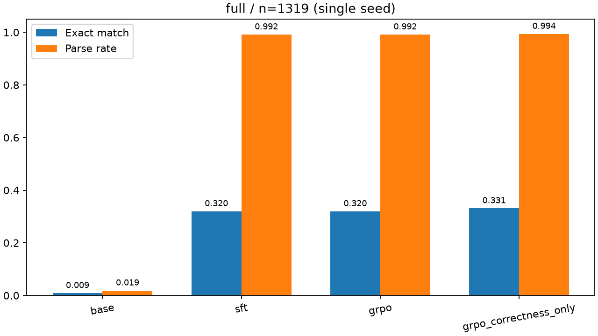

# ReasonForge-RL

基于 `Qwen/Qwen2.5-0.5B-Instruct` 的 GSM8K 数学推理后训练实验，在相同基座和评测条件下比较 **Base → LoRA/SFT → 从 SFT 继续 GRPO**，并开展正确性奖励消融。使用 TRL 与 PEFT 实现训练流程，不声称提出新算法。

## 实测结果

以下为 seed=42、全部 1319 道官方测试题上的严格数值匹配结果：

| 方法 | 正确数 / 测试题数 | 严格准确率 | 可解析率 |
|---|---:|---:|---:|
| Base | 12 / 1319 | 0.91% | 1.90% |
| LoRA + SFT | 422 / 1319 | 31.99% | 99.17% |
| SFT + GRPO | 422 / 1319 | 31.99% | 99.17% |
| 仅正确性奖励消融 | 437 / 1319 | 33.13% | 99.39% |



本次 GRPO 未超过 SFT；消融的单次差异不能证明稳定增益。Base 低分受严格末行答案格式影响，不应将差异全部解释为数学能力提升。Full 指 7345/128/1319 的训练候选池、验证集和完整官方测试集；GRPO 与消融各 256 步，未遍历全部训练题。

详细设置、资源口径、曲线、失败恢复与错误案例见 [实验报告](reports/experiment_report.md)。本地原实验的最终验收为 111 项测试通过；公开源码后续修订的测试数量以对应提交的实际验证为准。

## 实现内容

- 固定模型与数据 revision，按训练、验证、测试划分数据，校验成员与哈希，防止测试集进入训练。
- 基于 `SFTTrainer` 和 LoRA 训练，核验 prompt loss mask、参数更新、adapter 保存和重载。
- 基于 `GRPOTrainer` 从同一 SFT adapter 继续训练；设置冻结参考策略，组合正确性与格式奖励，审计组内方差及零方差组。
- 统一 prompt、greedy 生成参数和答案解析器，保存逐题预测；解析失败按错误计入完整分母。
- 支持完整 Trainer checkpoint 恢复、评测逐题续接、磁盘保护、日志、原始指标和真实曲线。

## 环境准备

本机已验证：Windows 11、Python 3.12.10、RTX 3050 Laptop 4 GB、PyTorch CUDA 12.8 wheel。依赖版本固定于 [requirements.txt](requirements.txt)。Linux 尚未验证。

以下命令在 Windows PowerShell 中运行：

```powershell
git clone https://github.com/ak10086cc/ReasonForge-RL.git
cd ReasonForge-RL
py -3.12 -m venv .venv
$python = ".venv/Scripts/python.exe"
& $python -m pip install -r requirements.txt
& $python -m pip check
$env:PYTHONDONTWRITEBYTECODE = '1'
```

入口默认使用项目内 `.venv`，可运行 `.\scripts\run.ps1 -Task info` 核实实际解释器；也可用 `-PythonPath` 明确指定。缺少环境时明确报错，不自动安装或回退到旧的外部环境。首次运行从 Hugging Face 下载公开模型与 `openai/gsm8k` 的 `main` 配置，模型和原始下载缓存保存在 `.cache/huggingface/hub/`，处理后的数据保存在 `.cache/huggingface/datasets/`，会占用项目所在磁盘。模型/数据 revision 已固定，无需付费 API；默认关闭训练上报与 Hub 上传。

## 快速验证与实验入口

先运行自动化测试，再执行真实 Smoke。Smoke 只有 2 条训练、2 条验证、2 道测试题，SFT/GRPO 各 1 步，用于验证流程，不代表正式效果。

```powershell
.\scripts\run.ps1 -Task info
.\scripts\run.ps1 -Task test
.\scripts\run.ps1 -Task pipeline -Config configs/smoke.yaml
```

运行入口默认 `info`，不会自动训练；测试夹具、可重定向的临时文件与绘图缓存写入 `tmp/`，HF 模型、数据、Xet 与辅助资产缓存写入项目 `.cache/huggingface/`，结束恢复调用方环境变量及目录。Python 通用 CLI 同样默认使用项目缓存，显式 HF 缓存环境变量可覆盖；应在导入相关库前设置。HF 用户认证、工具设置及共享 pip 缓存保持原位，不主动清空。`-Task help` 查看底层 CLI；分阶段和续跑可传 `-Phase`、`-RunDir`、`-ResumeCheckpoint`、`-EvalMaxSeconds` 或 `-EvalMaxSamples`。

公开检出不包含历史实验产物，因此普通 pytest 会跳过需显式提供 `--artifact-run` 的额外产物验收。模型更新测试使用微型模型，无需下载训练基座权重；prompt 与 loss mask 测试会加载固定 revision 的 Qwen 分词器，首次需要联网获取其配置和分词文件，离线运行须提前准备这些缓存。

Small 使用 128 条训练候选、16 条验证、32 道测试题，SFT 32 步、GRPO 16 步，并运行奖励消融：

```powershell
.\scripts\run.ps1 -Task pipeline -Config configs/small.yaml
```

SFT 会剔除超出长度上限的完整解答并记录 ID，不截断最终答案。实际样本数见运行的 `sft/summary.json`。每次新实验创建独立 `outputs/runs/<name>-<run_id>/`，命令输出 `RUN_DIR`，已有产物受到覆盖保护。

Full 需要较长时间，首次请先完成 Smoke/Small 和资源检查。以下各命令在前一阶段完成后分别执行，`$run` 必须替换为新准备阶段输出的实际目录：

```powershell
.\scripts\run.ps1 -Task pipeline -Config configs/full.yaml -Phase prepare
$run = 'outputs/runs/<本次命令输出的实际目录>'
.\scripts\run.ps1 -Task pipeline -Config configs/full.yaml -Phase baseline -RunDir $run
.\scripts\run.ps1 -Task pipeline -Config configs/full.yaml -Phase sft -RunDir $run
.\scripts\run.ps1 -Task pipeline -Config configs/full.yaml -Phase grpo -RunDir $run
.\scripts\run.ps1 -Task pipeline -Config configs/full.yaml -Phase ablation -RunDir $run
.\scripts\run.ps1 -Task pipeline -Config configs/full.yaml -Phase analyze -RunDir $run
```

`baseline` 先完成验证预检，再冻结评测契约并评测测试集。各后续阶段核验前置结果和模型衔接。根目录的协作规则、实施方案和个人资料不是运行前提，不随公开仓库分发。

## 断点恢复与结果核验

训练恢复通过 `--resume-checkpoint` 指向同一次运行的完整 Trainer 检查点，包含 optimizer、scheduler 和 RNG；不能用最终 adapter 代替。先检查 `failures.jsonl`、`status.json` 和最后完整检查点，再恢复对应训练阶段：

```powershell
# 替换为该阶段实际存在、早于最后一步的完整检查点。
.\scripts\run.ps1 -Task pipeline -Config configs/full.yaml -Phase grpo -RunDir $run -ResumeCheckpoint "$run/grpo/checkpoint-<实际步数>"
```

训练已经完成、只有评测未完成时，重复相同阶段命令并省略 `--resume-checkpoint`，会复用最终模型继续评测。`--eval-max-seconds`、`--eval-max-samples` 可限制每次新增评测量；续接时核验配置、数据、权重及已保存预测。正式比较应完成相同的完整测试集。

完成自己的实验后，可核验原始产物并预览报告：

```powershell
.\scripts\run.ps1 -Task test -ArtifactRun $run
# 仅预览报告，绘图缓存与预览都进入 tmp。
$env:MPLCONFIGDIR = Join-Path (Get-Location) "tmp/matplotlib"
& $python scripts/make_report.py --runs $run --output-dir tmp/report-preview
```

`--artifact-run` 可以重复传入。`make_report.py` 从实际提供的运行生成报告，未运行项明确标注；预览输出可删除，需要保留的正式报告应另行审阅归档。`run_*_stage.py` 是原始分阶段实验的审计/恢复入口，依赖对应本地快照和启动前记录，新实验使用上述通用 CLI。

## 目录与保存方式

| 目录 | 内容 |
|---|---|
| `src/reasonforge/` | 数据、prompt、奖励、训练、评测、恢复与存储逻辑 |
| `configs/` | Smoke、Small、Full 配置 |
| `scripts/` | 通用 CLI、资源探测、分析报告和阶段运行入口 |
| `tests/` | 数据隔离、loss mask、奖励、真实参数更新、保存重载、恢复与指标测试 |
| `reports/` | 筛选后的实验报告和展示图表 |
| `outputs/runs/` | 本地配置、源码快照、日志、预测、模型、检查点和验收记录 |
| `.cache/huggingface/` | 本地可复用的基座模型、原始下载和处理后的数据缓存，不上传 |
| `tmp/` | 测试样例、预览等可丢弃临时内容，进程停止后可整目录清理 |

公开仓库不包含模型权重、数据缓存、逐题预测、原始日志、个人简历及内部协作资料。报告中的历史 run_id/outputs 路径定位本机保留的证据，不随克隆分发；重新运行会生成自己的产物。原实验时尚无 Git commit，源码快照用于追溯，不能把后来的发布提交冒充实验当时的版本。

## 实验限制

单 seed、单一英文 GSM8K 数据集不能证明稳定增益或跨领域泛化；公开模型可能在预训练时接触过相关数据。严格格式要求与生成截断会影响准确率，因此同时报告可解析率、完成率和生成长度。

SFT/消融曾发生 CUDA 错误并从已核验检查点恢复。恢复调用的耗时、峰值显存不能冒充全程测量；Base/SFT 与 GRPO/消融之间的驱动版本不同。这些限制和负结果均保留在实验报告中。多 seed、独立 1.5B、跨数据集实验未运行。

## 参考与许可

- [Qwen2.5-0.5B-Instruct](https://huggingface.co/Qwen/Qwen2.5-0.5B-Instruct)、[GSM8K](https://huggingface.co/datasets/openai/gsm8k)
- [TRL SFT](https://huggingface.co/docs/trl/sft_trainer)、[TRL GRPO](https://huggingface.co/docs/trl/grpo_trainer)、[PEFT](https://huggingface.co/docs/peft/)

本仓库用于个人项目展示与复现，目前未单独授予代码复用许可。外部模型、数据和依赖遵循各自许可证，权重与原始数据未随仓库分发。
