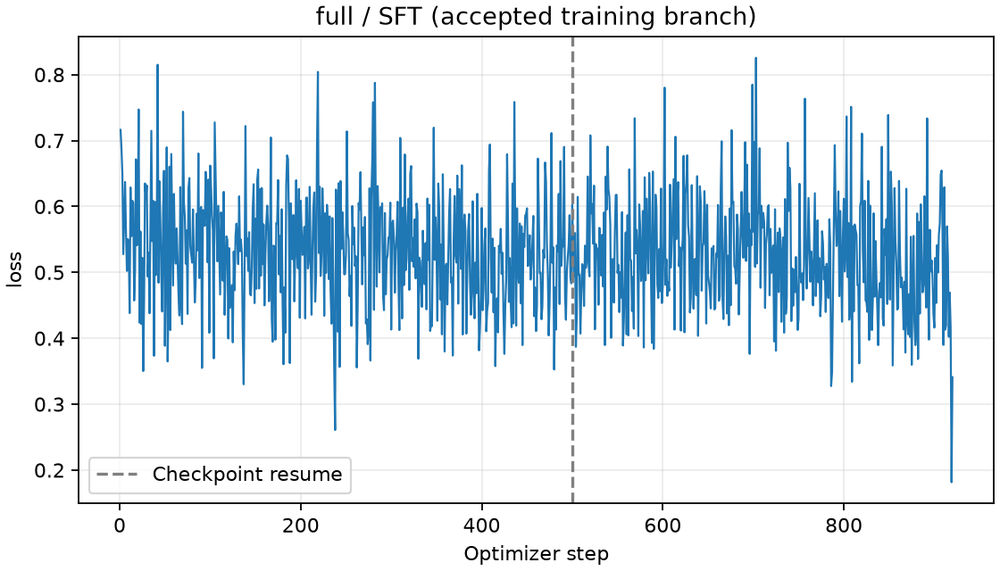
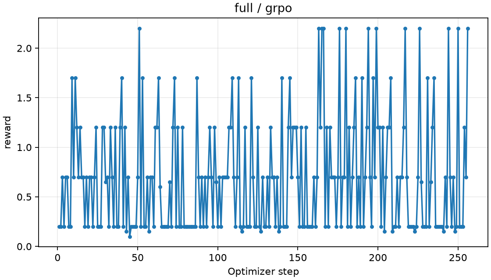
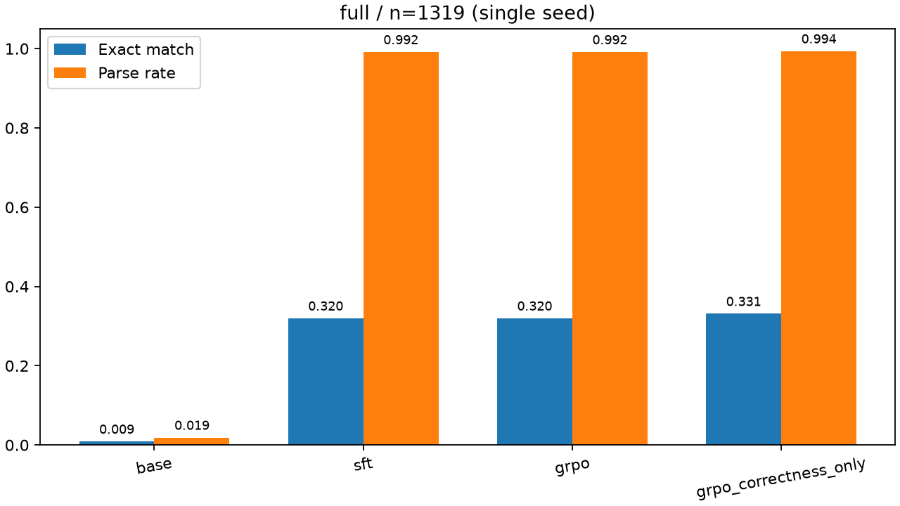

# ReasonForge-RL 实验报告

## 结论与边界

仅汇总下列输入运行的可核验产物；未提供不等于在其他目录从未运行。Smoke 仅验证流程；Small 是小样本探索。单次实验不能证明稳定增益。严格格式解析与生成截断都会影响准确率。

## 实际结果

| 规模 | 阶段 | n | 正确数 | Exact Match | 可解析率 | 完成率 | 平均生成 token | 评测秒数 |
|---|---|---:|---:|---:|---:|---:|---:|---:|
| smoke | base | 2 | 0 | 0.00% | 0.00% | 50.00% | 179.00 | 12.40 |
| smoke | sft | 2 | 0 | 0.00% | 0.00% | 50.00% | 178.50 | 20.07 |
| smoke | grpo | 2 | 0 | 0.00% | 0.00% | 50.00% | 174.50 | 18.77 |
| smoke | grpo_correctness_only | 未运行 | — | — | — | — | — | — |
| small | base | 32 | 0 | 0.00% | 0.00% | 40.62% | 229.97 | 260.39 |
| small | sft | 32 | 7 | 21.88% | 93.75% | 100.00% | 94.25 | 163.69 |
| small | grpo | 32 | 8 | 25.00% | 93.75% | 100.00% | 95.03 | 164.96 |
| small | grpo_correctness_only | 32 | 7 | 21.88% | 96.88% | 100.00% | 94.72 | 165.51 |
| full | base | 1319 | 12 | 0.91% | 1.90% | 96.97% | 263.91 | 11478.57 |
| full | sft | 1319 | 422 | 31.99% | 99.17% | 99.77% | 89.98 | 6438.23 |
| full | grpo | 1319 | 422 | 31.99% | 99.17% | 99.77% | 87.56 | 6649.45 |
| full | grpo_correctness_only | 1319 | 437 | 33.13% | 99.39% | 99.92% | 88.27 | 6513.73 |

本报告未提供的规模：无。

## 实验设置与资源

### smoke / smoke-20261106T035154814916Z

模型 Qwen/Qwen2.5-0.5B-Instruct，revision 7ae557604adf67be50417f59c2c2f167def9a775；GSM8K main revision 740312add88f781978c0658806c59bc2815b9866；seed=42。
实际候选 train/validation/test=2/2/2；数据划分证据：../outputs/runs/smoke-20261106T035154814916Z/data/manifest.json。
设备：NVIDIA GeForce RTX 3050 Laptop GPU；总显存 MiB：4095.50；torch CUDA runtime：12.8。
依赖：torch=2.11.0+cu128、transformers=5.22.1、trl=1.17.1、peft=0.21.2、accelerate=1.15.0、datasets=5.1.0、tokenizers=0.23.3、numpy=2.5.4、pandas=3.1.1、matplotlib=3.11.2、pytest=9.2.0、PyYAML=6.0.3。
实际配置：{"lora": {"r": 16, "alpha": 32, "dropout": 0.05, "target_modules": ["q_proj", "k_proj", "v_proj", "o_proj"]}, "sft": {"batch_size": 1, "gradient_accumulation_steps": 1, "learning_rate": 0.0002, "max_steps": 1, "max_length": 512, "save_steps": 1}, "grpo": {"batch_size": 1, "gradient_accumulation_steps": 4, "learning_rate": 5e-06, "max_steps": 1, "save_steps": 1, "num_generations": 4, "max_completion_length": 192, "temperature": 1.0, "beta": 0.04, "reward_weights": [2.0, 0.2]}, "evaluation": {"max_new_tokens": 192, "temperature": 0}}。

GRPO 相比 SFT 正确数差为 0 题，分母 2；不能据此认定因果增益或稳定提升。

### small / small-20261106T032826964295Z

模型 Qwen/Qwen2.5-0.5B-Instruct，revision 7ae557604adf67be50417f59c2c2f167def9a775；GSM8K main revision 740312add88f781978c0658806c59bc2815b9866；seed=42。
实际候选 train/validation/test=128/16/32；数据划分证据：../outputs/runs/small-20261106T032826964295Z/data/manifest.json。
设备：未记录 GPU / CPU；总显存 MiB：未记录；torch CUDA runtime：未记录。
依赖：torch=2.11.0+cu128、transformers=5.22.1、trl=1.17.1、peft=0.21.2、accelerate=1.15.0、datasets=5.1.0、tokenizers=0.23.3、numpy=2.5.4、pandas=3.1.1、matplotlib=3.11.2、pytest=9.2.0、PyYAML=6.0.3。
实际配置：{"lora": {"r": 16, "alpha": 32, "dropout": 0.05, "target_modules": ["q_proj", "k_proj", "v_proj", "o_proj"]}, "sft": {"batch_size": 1, "gradient_accumulation_steps": 4, "learning_rate": 0.0002, "max_steps": 32, "max_length": 512, "save_steps": 16}, "grpo": {"batch_size": 1, "gradient_accumulation_steps": 4, "learning_rate": 5e-06, "max_steps": 16, "save_steps": 8, "num_generations": 4, "max_completion_length": 256, "temperature": 1.0, "beta": 0.04, "reward_weights": [2.0, 0.2]}, "evaluation": {"max_new_tokens": 256, "temperature": 0}}。

GRPO 相比 SFT 正确数差为 1 题，分母 32；不能据此认定因果增益或稳定提升。

### full / full-20261107T015504132102Z

模型 Qwen/Qwen2.5-0.5B-Instruct，revision 7ae557604adf67be50417f59c2c2f167def9a775；GSM8K main revision 740312add88f781978c0658806c59bc2815b9866；seed=42。
实际候选 train/validation/test=7345/128/1319；数据划分证据：../outputs/runs/full-20261107T015504132102Z/data/manifest.json。
设备：NVIDIA GeForce RTX 3050 Laptop GPU；总显存 MiB：4095.50；torch CUDA runtime：12.8。
依赖：torch=2.11.0+cu128、transformers=5.22.1、trl=1.17.1、peft=0.21.2、accelerate=1.15.0、datasets=5.1.0、tokenizers=0.23.3、numpy=2.5.4、pandas=3.1.1、matplotlib=3.11.2、pytest=9.2.0、PyYAML=6.0.3。
实际配置：{"lora": {"r": 16, "alpha": 32, "dropout": 0.05, "target_modules": ["q_proj", "k_proj", "v_proj", "o_proj"]}, "sft": {"batch_size": 1, "gradient_accumulation_steps": 8, "learning_rate": 0.0002, "max_steps": 920, "max_length": 768, "save_steps": 100}, "grpo": {"batch_size": 1, "gradient_accumulation_steps": 4, "learning_rate": 5e-06, "max_steps": 256, "save_steps": 64, "num_generations": 4, "max_completion_length": 512, "temperature": 1.0, "beta": 0.04, "reward_weights": [2.0, 0.2]}, "evaluation": {"max_new_tokens": 512, "temperature": 0}}。

GRPO 相比 SFT 正确数差为 0 题，分母 1319；不能据此认定因果增益或稳定提升。

显存为当前进程的峰值分配/保留值，不等于整卡占用。分批评测耗时按已记录调用累计；强制结束进程可能缺失部分耗时，具体口径见 metrics.json 的 resource_scope。

| 规模 | 阶段 | 进入 Trainer 样本 | 已执行步数 | 训练与验证秒数 | 峰值分配 MiB | 峰值保留 MiB | 最大参数变化 |
|---|---|---:|---:|---:|---:|---:|---:|
| smoke | sft | 2 | 1 | 1.30 | 1128.20 | 1416.00 | 0.00019999995 |
| smoke | grpo | 2 | 1 | 13.82 | 1259.54 | 1344.00 | 4.9998926e-06 |
| small | sft | 128 | 32 | 53.45 | 1361.35 | 2274.00 | 0.0055476781 |
| small | grpo | 128 | 16 | 164.36 | 1438.61 | 1922.00 | 6.8422873e-05 |
| small | grpo_correctness_only | 128 | 16 | 177.34 | 1438.61 | 2228.00 | 7.1672723e-05 |
| full | sft | 7345 | 920 | 1299.90 | 1442.36 | 3402.00 | 0.031150542 |
| full | grpo | 7345 | 256 | 2717.52 | 1662.26 | 2670.00 | 0.00045787357 |
| full | grpo_correctness_only | 7345 | 256 | 684.90 | 1616.77 | 2654.00 | 0.00021103723 |

SFT 训练计时包含阶段内验证；模型加载和最终保存不在此列。GRPO 包含 rollout 与优化。恢复训练的 summary 可能仅计当前调用，须核对 resource_scope。

## 奖励诊断与错误分析

### smoke

- grpo：1 个 rollout 批次，4 个生成回答；批次等权 reward 均值=0.000000、方差均值=0.000000；正确性=0.00%、格式率=0.00%、零方差组比例=100.00%。
- base：未解析且未结束 1 题；已结束但格式不合规 1 题；数值错误 0 题。

案例 base/official_test:0：真值 18，提取 None。

>  eggs laid in a day**:     \[    16 \text{ (eggs per day)} + 3 \text{ (breakfast) + } 4 \text{ (baked)} = 23 \text{ (total eggs)}    \]  2. **Eggs eaten in the morning**:    \[    3 \text{ (eggs)}    \]    So, the number

案例 base/official_test:1：真值 3，提取 None。

> bolt.  3. **Total Number of Bolts Needed**:    - We add the number of blue and white bolts together:      \[      2 \text{ (blue)} + 1 \text{ (white)} = 3 \text{ bolts}      \]  Thus, the final answer is: \[ \boxed{3} \]
- sft：未解析且未结束 1 题；已结束但格式不合规 1 题；数值错误 0 题。

案例 sft/official_test:0：真值 18，提取 None。

> il:  1. The total number of eggs laid by the ducks in a day is:    \[    16 \text{ eggs/day} + 3 \text{ eggs (breakfast)} + 4 \text{ eggs (baked)} = 23 \text{ eggs/day}    \]  2. After subtracting the 3 eggs eaten in the

案例 sft/official_test:1：真值 3，提取 None。

> al Number of Bolts Needed**:    - We add the number of blue and white bolts together:      \[      2 \text{ (blue)} + 1 \text{ (white)} = 3 \text{ bolts}      \]  Thus, the total number of bolts needed for the robe is 3.
- grpo：未解析且未结束 1 题；已结束但格式不合规 1 题；数值错误 0 题。

案例 grpo/official_test:0：真值 18，提取 None。

>  Janet's ducks lay 16 eggs per day.  Next, step 2: She eats 3 eggs for breakfast every morning, so the number of eggs left after breakfast is \(16 - 3 = 13\).  Then, step 3: She bakes 4 muffins for her friends every day,

案例 grpo/official_test:1：真值 3，提取 None。

> *Total Number of Bolts Needed**:    - We add the number of bolts of blue and white fiber together.    - Total bolts = Blue fiber + White fiber = \( 2 + 1 = 3 \).  Thus, the total number of bolts needed for the robe is 3.

### small

- grpo：16 个 rollout 批次，64 个生成回答；批次等权 reward 均值=0.768750、方差均值=0.478438；正确性=29.69%、格式率=87.50%、零方差组比例=25.00%。
- grpo_correctness_only：16 个 rollout 批次，64 个生成回答；批次等权 reward 均值=0.437500、方差均值=0.531250；正确性=21.88%、格式率=87.50%、零方差组比例=31.25%。
- base：未解析且未结束 19 题；已结束但格式不合规 13 题；数值错误 0 题。

案例 base/official_test:0：真值 18，提取 None。

> *:    \[    3 \text{ (eggs)}    \]    So, the number of eggs left after breakfast is:    \[    23 - 3 = 20 \text{ (remaining eggs)}    \]  3. **Eggs baked**:    \[    4 \text{ (eggs)}    \]    So, the number of eggs left

案例 base/official_test:1：真值 3，提取 None。

> bolt.  3. **Total Number of Bolts Needed**:    - We add the number of blue and white bolts together:      \[      2 \text{ (blue)} + 1 \text{ (white)} = 3 \text{ bolts}      \]  Thus, the final answer is: \[ \boxed{3} \]
- sft：未解析且未结束 0 题；已结束但格式不合规 2 题；数值错误 23 题。

案例 sft/official_test:0：真值 18，提取 1800。

> has 36 eggs because 16 x 2 = 36 She makes $90 a week because 36 / 4 = 9 She makes $270 a month because 9 x 4 = 36 She makes $540 a year because 36 x 4 = 144 She makes $1800 a year because 540 / 3 = 180 Final Answer: 1800

案例 sft/official_test:2：真值 70000，提取 65。

> he house was $80,000 + $50,000 = $130,000. This increase in value is equal to 150% of $130,000 which is 150/100 * $130,000 = $195,000. So his gain from selling the house is $195,000 - $130,000 = $65,000. Final Answer: 65
- grpo：未解析且未结束 0 题；已结束但格式不合规 2 题；数值错误 22 题。

案例 grpo/official_test:2：真值 70000，提取 65。

> ost of the house was $80,000 + $50,000 = $130,000. The increase in value is 150% of $130,000 which is 150/100 * $130,000 = $195,000. So his profit from selling the house is $195,000 - $130,000 = $65,000. Final Answer: 65

案例 grpo/official_test:4：真值 20，提取 85。

> Wendi has a total of 20+20=40 chickens. She uses 3*40=120 cups of feed for all her chickens. In the final meal of the day, she needs to give her chickens 120-15-25=85 cups of feed. Final Answer: 85
- grpo_correctness_only：未解析且未结束 0 题；已结束但格式不合规 1 题；数值错误 24 题。

案例 grpo_correctness_only/official_test:0：真值 18，提取 540。

> She has 36 eggs because 16 x 2 = 36 She makes $90 a week because 36 / 4 = 9 She makes $270 a month because 9 x 30 = 270 She makes $540 a year because 270 x 4 = 540 Final Answer: 540

案例 grpo_correctness_only/official_test:2：真值 70000，提取 110500。

> The total cost of the house was $80,000 + $50,000 = $130,000. The increase in value is $130,000 * .15 = $19,500. So his profit from this purchase was $130,000 - $19,500 = $110,500. Final Answer: 110500

### full

- grpo：256 个 rollout 批次，1024 个生成回答；批次等权 reward 均值=0.694336、方差均值=0.411064；正确性=24.90%、格式率=98.14%、零方差组比例=46.48%。
- grpo_correctness_only（原始审计，含回滚放弃的尝试）：267 个 rollout 批次，1068 个生成回答；批次等权 reward 均值=0.552434、方差均值=0.418539；正确性=27.62%、格式率=97.38%、零方差组比例=50.19%。
- base：未解析且未结束 39 题；已结束但格式不合规 1255 题；数值错误 13 题。

案例 base/official_test:0：真值 18，提取 None。

>   \]    Therefore, the total revenue from selling the remaining eggs is:    \[    16 \text{ (remaining eggs)} \times \$2/\text{egg} = \$32    \]  Thus, Janet makes \(\boxed{32}\) dollars every day at the farmers' market.

案例 base/official_test:1：真值 3，提取 None。

> bolt.  3. **Total Number of Bolts Needed**:    - We add the number of blue and white bolts together:      \[      2 \text{ (blue)} + 1 \text{ (white)} = 3 \text{ bolts}      \]  Thus, the final answer is: \[ \boxed{3} \]
- sft：未解析且未结束 3 题；已结束但格式不合规 8 题；数值错误 886 题。

案例 sft/official_test:0：真值 18，提取 734。

> She has 360 eggs because 7 x 54 = 360 She eats 360 + 3 + 4 = 367 eggs a day She makes $890 from selling the eggs because 367 x 2 = 734 Final Answer: 734

案例 sft/official_test:1：真值 3，提取 6。

> It takes 2*2=4 bolts of blue fiber. It takes 4/2=2 bolts of white fiber. So in total, it takes 4+2=6 bolts. Final Answer: 6
- grpo：未解析且未结束 3 题；已结束但格式不合规 8 题；数值错误 886 题。

案例 grpo/official_test:0：真值 18，提取 2640。

> She has 360 eggs because 7 x 54 = 360 She eats 360 + 480 + 480 = 1,320 eggs a week She makes $1,920 from selling the eggs because 1,320 x 2 = 2,640 Final Answer: 2640

案例 grpo/official_test:1：真值 3，提取 6。

> It takes 2*2=4 bolts of blue fiber. It takes 4/2=2 bolts of white fiber. So in total, it takes 4+2=6 bolts. Final Answer: 6
- grpo_correctness_only：成功训练分支 256 个 rollout 批次，1024 个回答；批次等权 reward 均值=0.529297、方差均值=0.416992；正确性=26.46%、格式率=97.46%、零方差组比例=50.39%。

案例 grpo_correctness_only/official_test:0：真值 18，提取 734。

> She has 360 eggs because 7 x 54 = 360 She eats 360 + 3 + 4 = 367 eggs a day She makes $890 from selling the eggs because 367 x 2 = 734 Final Answer: 734

案例 grpo_correctness_only/official_test:1：真值 3，提取 6。

> It takes 2*2=4 bolts of blue fiber. It takes 4/2=2 bolts of white fiber. So in total, it takes 4+2=6 bolts. Final Answer: 6

零方差组没有相对奖励信号；权重变化也可能来自 KL 或数值差异，须结合 reward、KL、clip 和截断诊断。

## 曲线

## 可追溯证据

以下 outputs 路径对应本机保留的历史证据，未随公开仓库分发；公开图表和指标为该次运行的汇总。源码、配置与模型/数据 revision 可用于新建独立复现实验。原始交付文档已存档，发布仅调整文档展示与本机路径隐私，不改写实验结果。

- smoke：../outputs/runs/smoke-20261106T035154814916Z；实际命令：["python.exe", "scripts/run_pipeline.py", "--config", "configs/smoke.yaml"]；Git commit：unavailable (exit 128)。
- small：../outputs/runs/small-20261106T032826964295Z；实际命令：["python.exe", "scripts/run_pipeline.py", "--config", "configs/small.yaml"]；Git commit：unavailable (exit 128)。
- full：../outputs/runs/full-20261107T015504132102Z；实际命令：["python.exe", "scripts/run_pipeline.py", "--config", "configs/full.yaml", "--phase", "prepare"]；Git commit：unavailable (exit 128)。

## 测试

导入 pytest 记录：111 通过、0 失败、0 跳过；原始 XML：../outputs/runs/full-20261107T015504132102Z/stage6/validation/final/pytest.xml。历史记录不等于本轮重新测试。

## 限制与未完成项

Full 核心三阶段已有完整评测产物。
多 seed、独立 1.5B 等实验状态以显式提供的运行证据为准；本报告不推断。
GSM8K 单数据集存在泛化局限，公开模型可能存在预训练污染。所有调参仅用训练/验证集；测试结果不得用于选择参数或挑选有利运行。

## Full 实验解释与恢复记录

SFT 与 GRPO 的正确数差为 0，共同分母 1319；本次结果不支持 GRPO 提高准确率的结论。相同总正确数也不表示每题预测一致。配对统计如下（left/right 顺序见名称）：

- sft_vs_grpo：{"both_correct": 374, "left_only_correct": 48, "right_only_correct": 48, "both_wrong": 849}。
- grpo_vs_correctness_only：{"both_correct": 381, "left_only_correct": 41, "right_only_correct": 56, "both_wrong": 841}。

Full SFT 首次于 2026-11-07 14:12 出现 CUDA unknown error，原因未确定，未发现 OOM 记录；核验权重、优化器、调度器与 GPU 后，于 15:42 从第 500 步继续，最终达到第 920 步。失败与恢复证据保留在 stage4/recovery.json、failures.jsonl 和原日志。SFT summary 的 1299.90 秒和 1442.36/3402 MiB 仅覆盖成功恢复调用，首次失败调用的完整耗时和峰值缺失，不能合计或反推。SFT 曲线选择成功分支的 920 个 loss 点，排除被回滚的尝试，不对重复步骤取平均；原始日志保持不变，选择依据见 stage6/curve_provenance.json。

GRPO 与消融各配置 256 个更新步，每题 4 个回答；7345 是候选训练集大小，不能声称 RL 遍历了全部 7345 题。消融实际不同训练问题数为 256，与主 GRPO 的问题顺序一致性为 True。只去掉格式奖励，其余设置保持一致；单 seed 结果不构成稳定增益或奖励方案优劣的证明。

Base/SFT 历史显卡驱动记录为 610.60，GRPO/消融阶段检测为 621.14；驱动变更并非项目操作，PyTorch CUDA wheel 12.8 与 Python 依赖未变。该环境差异为复现限制；冻结评测协议、输入、源码和权重衔接已核验。

多 seed、独立 1.5B 和跨数据集泛化实验未运行。项目由 Codex 协助实现，简历使用者须能解释训练、奖励、数据隔离及负结果，不能宣称独立原创算法。

实际执行：项目根目录专用 Python 运行 scripts/run_delivery_stage.py --config configs/full.yaml --run-dir outputs/runs/full-20261107T015504132102Z；该入口依次调用 ablation、分析、三个规模的 pytest 产物验收和报告生成。完整命令与原始日志见 stage6。

Full 消融首次运行于 2026-11-07 21:57 报 CUDA out of memory，最后日志 202 步，已核验第 192 步完整检查点、优化器、调度器、冻结参考权重与当前 CUDA 运算，用新进程保持原配置恢复。具体诱因未确定，未修改系统内存设置。原始审计共 267 批，其中 11 批属于回滚放弃的尝试，正式奖励统计仅使用成功分支，原始文件保留。消融 summary 的耗时、峰值显存和参数变化仅覆盖从检查点恢复的调用，首次失败调用缺少完整资源记录，不冒充总耗时或全程峰值。证据见 stage6/recovery.json。
